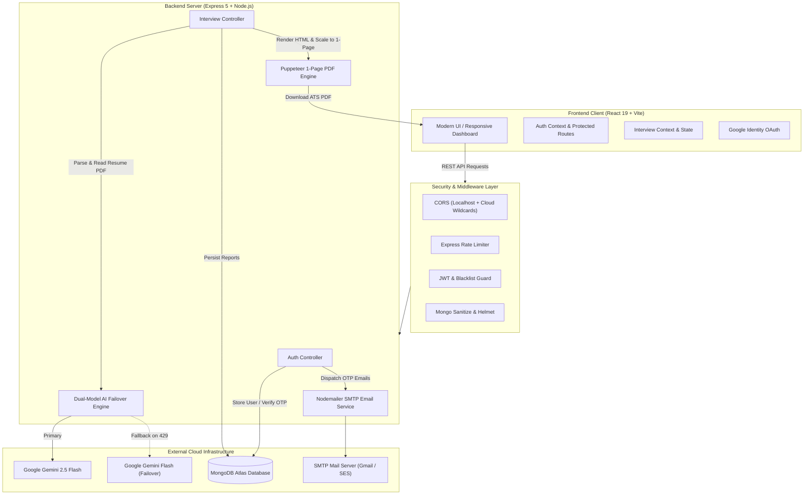

# 🚀 PrepAI — Full-Stack GenAI Technical Interview & ATS Resume Platform

<div align="center">


<br/>

[](https://react.dev/)
[](https://nodejs.org/)
[](https://www.mongodb.com/)
[](https://ai.google.dev/)
[](https://pptr.dev/)
[](LICENSE)

**An enterprise-grade, full-stack AI career preparation platform that transforms job descriptions and candidate resumes into customized FAANG-level interview strategies, diagnostic skill roadmaps, and strictly 1-page ATS-optimized resumes.**

[Features](#-key-features) • [Architecture](#-system-architecture) • [Tech Stack](#-tech-stack) • [Getting Started](#-getting-started) • [API Reference](#-api-endpoints) • [Deployment](#-deployment-guide)

</div>

---

## 🌟 Key Features

### 🎯 1. Tailored AI Interview Intelligence
- **Candidate-Job Alignment Engine:** Matches candidate backgrounds against target Job Descriptions (JD) to compute an accurate **Match Score (0–100%)**.
- **FAANG-Grade Technical Questions:** Generates role-specific coding, system design, and framework questions accompanied by **Interviewer Intention diagnostics** and comprehensive **Model Answers**.
- **STAR Behavioral Scenarios:** Contextual behavioral questions with structured Situation, Task, Action, and Result frameworks.
- **Diagnostic Skill Gap Analysis:** Highlights missing competencies categorized by severity badges (`High`, `Medium`, `Low`).
- **5-Day Actionable Preparation Plan:** Daily structured focus topics and concrete coding tasks.

### 📄 2. Strictly 1-Page ATS Resume Compiler
- **Guaranteed Single-Page A4 PDF:** Solves the common multi-page spill-over issue using Puppeteer with dynamic DOM `scrollHeight` calculation, proportional auto-scaling, and `pdf-parse` self-correction verification loops.
- **Zero-Hallucination Factual Grounding:** Strictly preserves the candidate's real identity, university degrees, and actual projects. No fabricated employers (e.g., "InnovateTech") or fake colleges.
- **Google XYZ Formula Bullet Points:** Elevates bullet points using the proven formula: *"Accomplished [X], as measured by [Y], by doing [Z]"* with high-impact action verbs and JD keywords.
- **Cross-Platform PDF Worker:** Automatically resolves local Google Chrome / Microsoft Edge on Windows and macOS, and leverages `@sparticuz/chromium` in Linux/serverless cloud production.

### ⚡ 3. Resilient Dual-Model AI Architecture
- **Automatic Quota Failover:** Primary model uses **Google Gemini 2.5 Flash**. If free-tier rate limits or `429 Quota Exceeded` spikes occur, the backend seamlessly falls back to **Gemini Flash Latest** without crashing or returning mock data.
- **Structured Schema Enforcing:** All AI outputs adhere to strict Zod schemas and JSON-only response contracts with recursive safety parsers.

### 🔐 4. Enterprise-Grade Authentication & Security
- **1-Click Google Sign-In:** Integrated Google Identity Services (`@react-oauth/google`) with token exchange verification.
- **Secure Password Recovery:** 6-digit OTP verification powered by `nodemailer` with a branded HTML template, 10-minute expiry, 60s resend cooldown, and 3-attempt brute-force protection.
- **Zero Credential UI Leakage:** Server never exposes OTPs or private hashes in API responses or browser state.
- **Interactive Security UI:** Show/Hide password toggles and discrete 6-box auto-advancing PIN inputs with backspace and paste support.
- **Token Blacklisting:** Cookie-based JWT authentication with active MongoDB token blacklist on logout.

---

## 📐 System Architecture



---

## 💻 Tech Stack

### Frontend
- **Framework:** React 19 (Vite 8)
- **Routing:** React Router v7
- **Styling:** Modular SCSS (BEM architecture), CSS variables, responsive design
- **State Management:** React Context API + Custom Hooks (`useAuth`, `useInterview`)
- **Authentication:** Google OAuth2 Client (`@react-oauth/google`), Axios interceptors

### Backend
- **Runtime:** Node.js (>= 20.0.0)
- **Framework:** Express.js 5
- **Database:** MongoDB Atlas via Mongoose ODM
- **AI Integration:** `@google/genai` (Gemini 2.5 Flash + Flash Latest)
- **PDF Generation:** `puppeteer-core` with `@sparticuz/chromium`
- **PDF Parsing:** `pdf-parse`
- **Email Service:** `nodemailer`
- **Security:** `jsonwebtoken`, `bcryptjs`, `helmet`, `express-rate-limit`, `cookie-parser`, `express-mongo-sanitize`

---

## 📁 Project Structure

```text
GEN-AI/
├── BACKEND/
│   ├── src/
│   │   ├── config/
│   │   │   ├── database.js          # MongoDB Atlas connection
│   │   │   └── env.js               # Environment variables registry
│   │   ├── controllers/
│   │   │   ├── auth.controller.js   # Login, Register, Google Auth, OTP Reset
│   │   │   └── interview.controller.js # AI Report creation, Resume PDF controller
│   │   ├── middlewares/
│   │   │   ├── auth.middleware.js   # JWT validation & Token blacklist check
│   │   │   ├── error.middleware.js  # Global centralized error handler
│   │   │   └── file.middleware.js   # Multer in-memory PDF resume upload
│   │   ├── models/
│   │   │   ├── blacklist.model.js   # Revoked tokens TTL store
│   │   │   ├── interviewReport.model.js # Strategy reports schema
│   │   │   └── user.model.js        # User credentials & password reset fields
│   │   ├── routes/
│   │   │   ├── auth.routes.js       # Auth endpoint mappings
│   │   │   └── interview.routes.js  # Interview & PDF download routes
│   │   ├── services/
│   │   │   ├── ai.service.js        # Dual-Model AI failover & 1-page PDF engine
│   │   │   └── email.service.js     # Nodemailer SMTP OTP delivery service
│   │   └── app.js                   # Express app setup, CORS, reverse proxy trust
│   ├── .env.example                 # Documented backend environment template
│   ├── package.json                 # Backend dependencies & engine requirements
│   └── server.js                    # HTTP server bootstrap entry
│
├── Frontend/
│   ├── src/
│   │   ├── features/
│   │   │   ├── auth/
│   │   │   │   ├── components/      # ProtectedRoute, GoogleAuthButton
│   │   │   │   ├── hooks/           # useAuth hook
│   │   │   │   ├── pages/           # Login, Register, ForgotPassword, Navbar
│   │   │   │   └── services/        # auth.api.js (Axios)
│   │   │   └── interview/
│   │   │       ├── hooks/           # useInterview hook
│   │   │       ├── pages/           # Home (Input / Generator), Interview (Report UI)
│   │   │       └── services/        # interview.api.js
│   │   ├── app.routes.jsx           # Application routing tree
│   │   ├── App.jsx                  # App root
│   │   └── main.jsx                 # Entry point with Auth & Google OAuth providers
│   ├── .env.example                 # Documented frontend environment template
│   ├── package.json                 # Frontend dependencies
│   ├── vercel.json                  # Vercel SPA rewrite configuration
│   └── vite.config.js               # Vite build & plugin configuration
└── README.md                        # Project documentation
```

---

## 🛠️ Getting Started

### Prerequisites
- **Node.js:** v20.0.0 or higher
- **MongoDB:** A local MongoDB instance or a free [MongoDB Atlas](https://www.mongodb.com/cloud/atlas) cluster URI
- **Google AI Studio API Key:** Free key from [ai.google.dev](https://ai.google.dev/)
- **Google OAuth Client ID (Optional):** From [Google Cloud Console](https://console.cloud.google.com/)
- **SMTP Credentials (Optional for Email OTP):** Gmail App Password or SMTP provider

---

### Step 1: Clone the Repository
```bash
git clone https://github.com/your-username/PrepAI.git
cd PrepAI
```

---

### Step 2: Configure Backend Environment
```bash
cd BACKEND
cp .env.example .env
```
Edit `BACKEND/.env` with your values:
```env
PORT=5000
NODE_ENV=development
CLIENT_URL=http://localhost:5173

MONGO_URI=mongodb+srv://<username>:<password>@cluster0.mongodb.net/prepai?retryWrites=true&w=majority
JWT_SECRET=your_super_secret_jwt_random_key_here

GOOGLE_GENAI_API_KEY=your_gemini_api_key_here

# Optional: Google OAuth
GOOGLE_CLIENT_ID=your_google_client_id.apps.googleusercontent.com

# Optional: Email SMTP (for password reset OTPs)
EMAIL_SERVICE=gmail
EMAIL_USER=your_email@gmail.com
EMAIL_PASS=your_gmail_16_digit_app_password
EMAIL_FROM="PrepAI Support <your_email@gmail.com>"
```

Install dependencies and start the backend:
```bash
npm install
npm run dev
```
Backend will start on `http://localhost:5000`.

---

### Step 3: Configure Frontend Environment
In a new terminal:
```bash
cd ../Frontend
cp .env.example .env
```
Edit `Frontend/.env`:
```env
VITE_API_URL=http://localhost:5000/api
VITE_GOOGLE_CLIENT_ID=your_google_client_id.apps.googleusercontent.com
```

Install dependencies and run the client:
```bash
npm install
npm run dev
```
Frontend will be running on `http://localhost:5173`.

---

## 📡 API Endpoints

### 🔐 Authentication Routes (`/api/auth`)

| Method | Endpoint | Access | Description |
| :--- | :--- | :---: | :--- |
| `POST` | `/register` | Public | Register a new candidate account |
| `POST` | `/login` | Public | Authenticate user & issue HTTP-only JWT |
| `POST` | `/google` | Public | One-click Google OAuth verification |
| `GET` | `/logout` | Private | Revoke session & blacklist current token |
| `GET` | `/profile` | Private | Retrieve authenticated candidate profile |
| `POST` | `/forgot-password` | Public | Request 6-digit email OTP (Rate-limited) |
| `POST` | `/verify-reset-code`| Public | Validate submitted 6-digit OTP |
| `POST` | `/reset-password` | Public | Reset password with verified OTP |

### 💼 Interview & Resume Routes (`/api/interview`)

| Method | Endpoint | Access | Description |
| :--- | :--- | :---: | :--- |
| `POST` | `/generate-report` | Private | Upload resume & JD to generate AI strategy |
| `GET` | `/report/:interviewId`| Private | Retrieve a specific interview report |
| `GET` | `/reports` | Private | Get paginated list of candidate's reports |
| `GET` | `/resume/pdf/:interviewReportId` | Private | Download strictly 1-page ATS Resume PDF |

---

## 🚀 Deployment Guide

### Deploying Backend to Render / Railway / Cloud
1. Create a **Web Service** pointing to your repository with root directory set to `BACKEND`.
2. **Build Command:** `npm install`
3. **Start Command:** `node server.js`
4. Set all Environment Variables from `BACKEND/.env.example` in the host dashboard.
5. `app.js` is already configured with `app.set("trust proxy", 1)` and production CORS wildcard matching for `*.vercel.app`.

### Deploying Frontend to Vercel
1. Create a new Vercel project pointing to the repository with root directory set to `Frontend`.
2. **Framework Preset:** Vite
3. Set `VITE_API_URL` to your production backend URL (e.g., `https://your-backend.onrender.com/api`).
4. Set `VITE_GOOGLE_CLIENT_ID`.
5. The included `Frontend/vercel.json` automatically configures SPA routing rewrites:
```json
{
  "rewrites": [{ "source": "/(.*)", "destination": "/index.html" }]
}
```

---

## 🛡️ Factual Grounding & ATS Compliance Guarantee

```text
Input Resume (PDF / Text)
       │
       ▼
Extract Real Identity (Name, University, Actual Experience, Real Projects)
       │
       ▼
Google XYZ Formula Rewriting ("Accomplished [X] measured by [Y] by doing [Z]")
       │
       ▼
Dual-Model Gemini AI Optimization (Zero Hallucination Constraints)
       │
       ▼
Inject Single-Page Normalizer CSS (8.8pt font, 1.25 line-height, 8mm margins)
       │
       ▼
Puppeteer Dynamic Height Measurement & Native Scale Factor
       │
       ▼
pdf-parse Verification Loop (numpages === 1 Guarantee)
       │
       ▼
Recruiter-Ready 1-Page ATS Resume PDF
```

---

## 👨‍💻 Author

**Vivek Shukla**  
Master of Computer Applications (MCA) — *Jawaharlal Nehru University (JNU), New Delhi*  
- **GitHub:** [@vivek25tech](https://github.com/vivek25tech)  
- **LinkedIn:** [Vivek Shukla](https://linkedin.com/in/vivek-shukla)  
- **Email:** [vivek25tech@gmail.com](mailto:vivek25tech@gmail.com)

---

## 📄 License

This project is licensed under the [ISC License](LICENSE).
